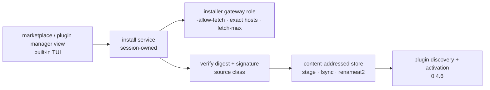
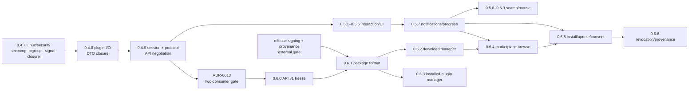

# Anvil Architecture Maps

Status: current as of 2026-11-03. Solid paths are implemented; dashed paths
are planned or debug-only. `0.4.6b` activation matching is landed; `0.5.x`
interaction/UI, `0.6.x` distribution, and Linux substrate work are planned in
the linked plans.

## Current architecture

```mermaid
flowchart TB
    subgraph TUI["anvil-tui · Rust · trusted"]
        MAIN["main / run loop"]
        KEYS["keys.rs<br/>input dispatch"]
        MODEL["Model<br/>buffers · cursor · viewport<br/>pending state · command state"]
        RENDER["render.rs<br/>editor · gutter · popups"]
        SYNTAX["syntax.rs worker<br/>Tree-sitter"]
        TREEUI["file_tree_ui.rs<br/>tree · fuzzy state"]
        LSPUI["lsp_ui.rs<br/>requests · completion · hover · definition<br/>code actions · rename · formatting · symbols"]
        PLUGINS["plugin_session + activation<br/>hosts keyed by plugin id"]
        IPC["anvil-ipc<br/>GatewayClient"]

        MAIN --> KEYS --> MODEL
        MODEL --> RENDER
        MODEL --> SYNTAX
        MODEL --> TREEUI
        MODEL --> LSPUI
        MODEL --> PLUGINS
        MODEL --> IPC
    end

    subgraph WORKERS["background workers"]
        FW["FileWorker<br/>own GatewayClient"]
        LW["LspWorker<br/>own GatewayClient"]
    end

    TREEUI --> FW
    LSPUI --> LW

    subgraph GATEWAY["anvil-gateway · Go · per session"]
        ROUTER["JSON-RPC router"]
        POLICY["capability policy"]
        FS["fsroot<br/>openat2 · RESOLVE_BENEATH"]
        EXEC["execpolicy"]
        FETCH["fetch<br/>SSRF constrained"]
        LSPMGR["internal/lsp<br/>process manager"]
    end

    IPC -- main UDS --> ROUTER
    FW -- worker UDS --> ROUTER
    LW -- worker UDS --> ROUTER

    ROUTER --> POLICY
    ROUTER --> FS
    ROUTER --> EXEC
    ROUTER --> FETCH
    ROUTER --> LSPMGR

    EXEC --> RUNNER["anvil-exec-runner<br/>Landlock · seccomp · cgroup"]
    RUNNER --> RG["rg / fd"]

    LSPMGR --> LS["rust-analyzer · gopls · pyright<br/>trusted · no sandbox"]

    subgraph PLUGIN["anvil-plugin-host · untrusted · Luau + sandbox"]
        PH["process group<br/>Luau entry · Landlock · seccomp · cgroup"]
    end

    PLUGINS -. token FD + activation --> PH
    PH -. sys.* UDS + token --> ROUTER

    subgraph CORE["Rust libraries"]
        EDITOR["anvil-editor"]
        CORE_TXT["anvil-core<br/>PieceTable · LineIndex"]
        API["anvil-api<br/>Rust DTOs · JSON Schema · TS/Lua"]
    end

    MODEL --> EDITOR
    MODEL --> CORE_TXT
    EDITOR --> API
```

### Current trust boundaries

| Component | Trust | Responsibility |
|---|---|---|
| `anvil-tui` | trusted | buffer, input, UI, command state, plugin activation |
| `anvil-gateway` | trusted | per-session policy and I/O |
| `anvil-exec-runner` | trusted | sandboxed `rg` / `fd` launch |
| LSP process | trusted | `-no-sandbox-lsp`, separate from plugin-host |
| `anvil-plugin-host` | untrusted | Luau entry loaded; Landlock/seccomp/cgroup sandbox; capability API pending |

## Future architecture

Dashed components are planned, not implemented.

```mermaid
flowchart TB
    subgraph TUI["anvil-tui · future"]
        KEYS2["keys.rs"]
        RENDER2["render.rs"]
        MODEL2["model.rs<br/>buffers · state · lifecycle"]
        FILEIO["file_io.rs<br/>async open/save"]
        CMD["commands.rs<br/>Ex · search · substitute"]
        LSPUI2["lsp_ui.rs<br/>async request orchestration"]
        WEDIT["workspace_edit.rs<br/>TextEdit / WorkspaceEdit"]
        TREE2["file_tree_ui.rs"]

        KEYS2 --> MODEL2
        MODEL2 --> RENDER2
        MODEL2 --> FILEIO
        MODEL2 --> CMD
        MODEL2 --> LSPUI2
        MODEL2 --> WEDIT
        MODEL2 --> TREE2
    end

    subgraph ASYNC["async workers"]
        OW["open/save worker<br/>generation cancellation"]
        FW2["FileWorker"]
        LW2["LspWorker"]
    end

    FILEIO --> OW
    TREE2 --> FW2
    LSPUI2 --> LW2

    subgraph LSP["LSP layer"]
        LM["language manager<br/>Rust · Go · Python"]
        LS2["rust-analyzer · gopls · pyright"]
        LM --> LS2
    end

    LW2 --> LM

    subgraph GATEWAY2["anvil-gateway · future"]
        ROUTER2["JSON-RPC router"]
        POLICY2["capability policy"]
        FS2["fsroot · openat2"]
        EXEC2["execpolicy"]
        FETCH2["fetch"]
        CONTROL["grant / control socket"]
        LSPMGR2["internal/lsp"]
    end

    OW --> ROUTER2
    FW2 --> ROUTER2
    LW2 --> ROUTER2

    ROUTER2 --> POLICY2
    ROUTER2 --> FS2
    ROUTER2 --> EXEC2
    ROUTER2 --> FETCH2
    ROUTER2 --> LSPMGR2
    CONTROL --> POLICY2
    LSPMGR2 --> LM

    EXEC2 --> RUNNER2["anvil-exec-runner"]
    RUNNER2 --> TOOLS["rg · fd"]

    subgraph PH2["anvil-plugin-host · future"]
        VM["Lua / QuickJS runtime"]
        SANDBOX["Landlock · seccomp · cgroup"]
        VM --> SANDBOX
    end

    CONTROL -. grants + token --> PH2
    PH2 -. sys.* --> ROUTER2

    subgraph CORE2["Rust libraries"]
        EDITOR2["anvil-editor"]
        CORE2_TXT["anvil-core"]
        API2["anvil-api"]
    end

    MODEL2 --> EDITOR2
    MODEL2 --> CORE2_TXT
    EDITOR2 --> API2
```

The planned `0.4.9` boundary extracts command registry, focus/overlay state,
effects, and plugin lifecycle from `anvil-tui` into `anvil-session`; the TUI
becomes an input adapter and renderer. `0.5.x` interaction state is session-owned;
the renderer must not become a second owner of focus, palette, or notification
state.

## Planned distribution path



The plugin host never receives the installer token or a network handle.
`0.5.7` supplies the notification/progress surface; it is not a dependency of
the package/download core.

## Delivery dependency graph



Parallel windows:

- After `0.4.9`: `0.5.1–0.5.6` and API-freeze work may run in parallel, but
  `0.6.0` cannot freeze until the ADR-0013 two-consumer gate passes.
- Package work waits for `0.6.0` **and** release signing/provenance; only then
  may package/download core `0.6.1–0.6.3` run in parallel with the UI line.
- `0.6.4`/`0.6.5` wait for `0.5.7`, `0.6.2`, and the signing gate; `0.6.1`
  does not wait for the UI line, but does wait for API freeze and signing.
- `0.6.3` depends only on `0.6.1`.
- Linux substrate work is not a separate release: L1 attaches to `0.4.7`, L2
  to `0.4.8`/`0.6.1`, and L3/L4 stay measurement-gated.
- Performance re-run points are defined in
  [performance.md](performance.md#11-re-run-triggers); full gates align with
  `0.4.9`, `0.6.0`/`0.6.1`, and release tags.

Plans:

- [0.5.x interaction/UI](0.5.x-plan.md)
- [0.6.x distribution](0.6.x-plan.md)
- [Linux platform](linux-platform-plan.md)
- [Command architecture](command-architecture-plan.md)
- [Performance gates](performance.md)
