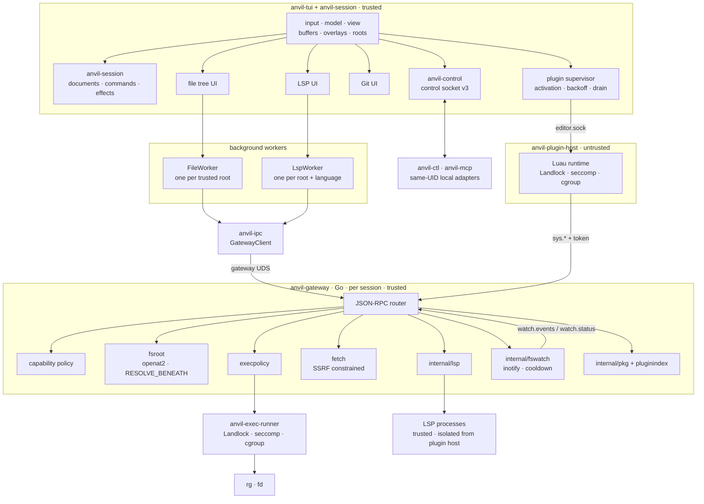
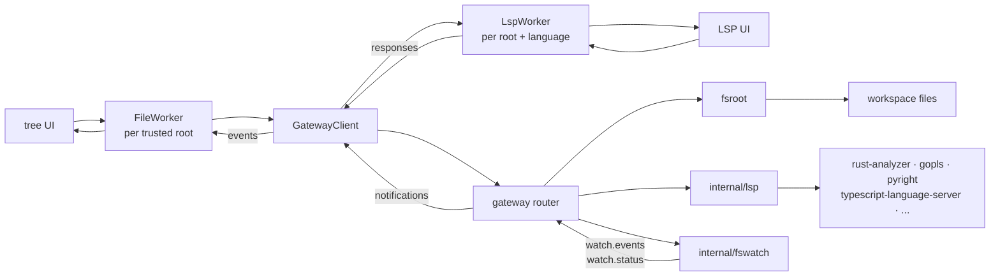
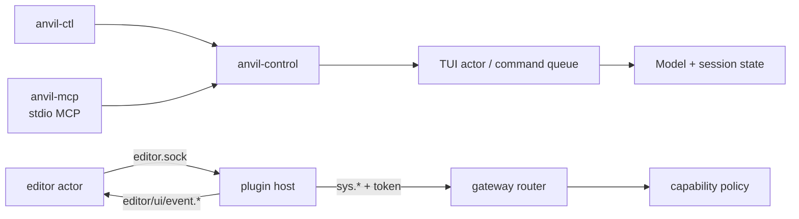
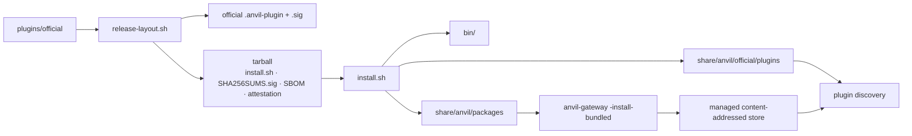
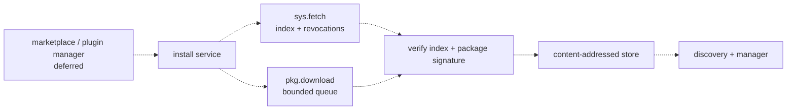

# Anvil Architecture Maps

Status: current as of 2026-11-24. Solid paths are implemented, including
asynchronous and out-of-process calls; dashed paths are deferred marketplace
work. `0.7.0` internal polish is complete, and `0.8.0` is the current workspace
release candidate. The `0.7.1`–`0.7.4` official modules are landed, and
marketplace/signed-index surfaces remain deferred. Layer rules and ownership stay in
[architecture.md](architecture.md); this file is the diagram view.

## 1. Process and trust boundaries

### Trust boundaries

| Component | Trust | Responsibility |
|---|---|---|
| `anvil-tui` | trusted | input, view, overlays, workspace roots, plugin activation |
| `anvil-session` | trusted | documents, command registry, effects, frontend-neutral state |
| `anvil-control` | trusted | workspace-keyed control socket and command manifest |
| `anvil-gateway` | trusted | per-session policy, file I/O, LSP, fetch, exec, watchers |
| `anvil-exec-runner` | trusted | sandboxed `rg` / `fd` launch |
| LSP process | trusted | language server; separate from the plugin sandbox |
| `anvil-plugin-host` | untrusted | Luau entry; Landlock/seccomp/cgroup; capability token only |
| Official modules | trusted | compiled-in source-level services |
| `anvil-ctl` / `anvil-mcp` | same-UID local adapter | routes through `anvil-control`; never writes workspace files directly |

## 2. File, LSP, and watch flow

Each trusted root owns one `FileWorker`; each root/language pair owns one
`LspWorker`. Native watch status is reported through the same gateway
connection, while polling remains the fallback for unsupported filesystems,
skipped directories, and failed or cooling-down native registration.

## 3. Control and plugin planes

`anvil-control` is editor-owned and keyed by canonical workspace. It is not a
plugin grant channel. Plugins cross two different boundaries: `editor.*` calls
go to the editor, while `sys.*` calls go to the gateway with a per-plugin token.

## 4. Distribution and module composition

The official-only path is landed: release layout, installer, bundled fallback,
and managed store.

Managed packages override bundled sources with the same plugin ID. The installer
is idempotent and is rerun on upgrade.

The marketplace path is deferred until the signed index, consent, revocation,
and production signing gates close. Package bytes never travel through
`sys.fetch`.

## 5. Delivery status

| Area | Status |
|---|---|
| `0.4.x` plugin lifecycle, I/O, session/protocol | landed |
| `0.5.x` modal editing and TUI interaction | landed |
| `0.6.0` internal polish | complete |
| `0.8.0` release candidate | prepared; ADR-0077 API break; production signing/provenance external |
| `0.6.1` package store and installed state | landed |
| `0.7.1`–`0.7.4` official modules | landed |
| Native workspace watch + live status | landed |
| Marketplace, signed-index UI, install/update consent | deferred |
| Release signing/provenance with production keys | external gate |
| Reference-machine performance baseline | recorded; rerun at boundaries |

Exit gates live in [internal-polish-plan.md](internal-polish-plan.md).
Architecture decisions and status live in the [ADR index](adr/README.md).
