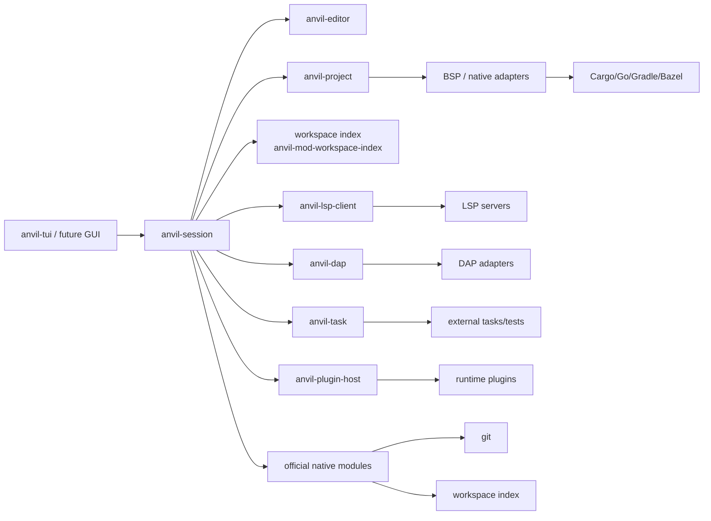

# IDE Platform Plan

Status: Active; project, integrations, symbol index, DAP, and runtime root landed

Scope: move Anvil from an editor with IDE features to a project-aware IDE
platform without turning the kernel into a language-specific compiler or
letting plugins become an execution bypass.

The decision boundary for extension classes, tool descriptors, and execution
trust is [ADR-0070](adr/0070-ide-extension-contributions-and-execution-trust.md).
This plan owns slices, acceptance criteria, and order.

## Current baseline

Already landed:

- selection-first editor core, multi-cursor, registers, macros, undo/redo;
- LSP client and language features: completion, navigation, diagnostics,
  code actions, format, rename, folding, semantic tokens, code lens,
  inlay hints, call hierarchy;
- basic DAP client: launch/attach, breakpoints, stepping, threads, stack,
  scopes, variables, watch, evaluate;
- task runner, test failure explorer, PTY terminal;
- Git diff, hunk staging, blame, and conflict handling;
- multi-root workspace routing and per-root gateways;
- workspace file index and gateway-backed search;
- runtime plugin host with commands, picker, completion, and existing
  capability-gated `sys.exec` / `sys.exec.v2`;
- compile-time official modules: Git, workspace index, desktop, LaTeX, Typst;
- `anvil-project` read-only model with a `cargo metadata` adapter;
- `anvil-integrations` closed capabilities and per-root grant matching;
- `anvil-mod-workspace-index` bounded symbols and occurrences with ranges;
- `anvil-dap` UI-neutral Debug Adapter Protocol client;
- `anvil-runtime` composition root for project, grants, and symbol services.

The remaining product gap is not basic editing. It is project awareness,
workspace-scale code intelligence, integration contribution, debugger depth,
remote development, and distribution/trust.

## Target architecture



The core continues to own text, selection, undo, focus, rendering, command
execution, and sandbox policy. Protocols own tool integration:

- LSP for language intelligence;
- DAP for debugger UI;
- BSP or native adapters for build targets and compiler inputs;
- gateway-mediated one-shot execution for formatters, linters, and tests.

## Workstreams

### A. Project model

Add `anvil-project` as a UI-neutral project description:

```text
Project
  roots[]
  targets[]
    id, name, kind
    source_roots[]
    dependencies[]
    can_build, can_test, can_run, can_debug
  run_configurations[]
  test_configurations[]
```

Discovery order:

1. Native adapter where a stable machine interface exists:
   - Cargo: `cargo metadata`;
   - Go: `go list -json`.
2. BSP for build servers that expose targets, sources, and capabilities.
3. Explicit user/workspace configuration.

The project model feeds:

- LSP workspace folders, root URI, and initialization options;
- index source roots;
- task and test targets;
- DAP launch configurations;
- project tree and run/test panels.

Do not parse every build file. Do not make BSP the only source; BSP is still a
non-approved standard.

### B. Workspace index

Extend the existing `anvil-mod-workspace-index` with workspace-scale code
intelligence. Introduce a separate `anvil-index` contract only if a second
consumer needs it.

```text
file index      path, language, size, mtime, hash
symbol index    definitions, references, implementations
occurrence      path + range + symbol + role
```

Use SCIP from external indexers where available; use LSP workspace symbols as
a fallback. The index is incremental, cancellable, persistent, and bounded.

Index construction introduces an explicit **dumb mode**:

- global symbols, references, and index-backed search are unavailable;
- editing, save, terminal, Git, and open-buffer features remain available;
- the status surface reports indexing progress and the reason for degradation.

Do not build a full PSI or type system for every language. Anvil should consume
compiler/language-server output, not replace it.

### C. Integration descriptors and trust

Follow ADR-0070:

- runtime plugins: commands, picker, completion, and existing capability-gated
  `sys.exec` / `sys.exec.v2`; no formatter/DAP/LSP/build descriptors or
  providers;
- native modules: trusted in-process code and declarative descriptors;
- user/workspace settings: trusted declarative descriptors;
- no runtime formatter/DAP/LSP provider;
- no manifest-to-exec shortcut.

Every descriptor has:

```text
id, kind, program, args, cwd, env allowlist, languages
```

Execution requires install, enable, workspace trust, capability grant, launch
approval, and gateway validation. Grants are per root and invalidated by
version, manifest hash, command, or root changes.

### D. Debugger and refactoring

Extend the existing DAP client rather than adding a second debugger stack:

- launch configuration schema and selection;
- conditional, log, and hit-count breakpoints;
- exception filters;
- multi-session and child sessions;
- REPL with completion;
- restart, terminate, and deterministic cleanup;
- inline values and source-map support where the adapter declares them.

Refactoring remains LSP-driven: code actions, prepare-rename, workspace edits,
and versioned document changes. Do not build language-specific refactoring
engines in the TUI.

### E. Remote workspace

Split local UI from remote workspace execution:

- local: input, rendering, local settings, and UI-owned state;
- remote: workspace files, LSP, DAP, build/task execution, and integration
  host;
- transport: explicit authenticated session, not a general remote shell.

Remote trust is per workspace and must not reuse local grants.

### F. Frontends

`anvil-tui` remains the first frontend. `anvil-session` stays frontend-neutral.
A future GUI is another client of the same session/command/effect surface, not
a reason to move UI state into the kernel.

## Slices

| Slice | Deliverable | Acceptance |
|---|---|---|
| S0 | ADR-0070 and this plan | Trust classes, capability names, gateway rules, and descriptor lifecycle are agreed |
| S1 | `anvil-project` read-only model + Cargo adapter | Open a Cargo workspace; report roots, targets, source roots, and capabilities |
| S2 | Go adapter + BSP client | Open a Go module and one BSP workspace; targets resolve without parsing build files |
| S3 | Run and test configurations | Select a target, run it, see structured task output, and jump to failures |
| S4 | Workspace symbol/occurrence layer + SCIP import | Global symbols/references work; indexing is cancellable and dumb mode surfaces |
| S5 | Descriptor registry and trust store | A descriptor cannot start without grant; per-root invalidation and exact command review work |
| S6 | DAP depth | Conditional/log breakpoints, exception filters, multi-session, REPL |
| S7 | Remote workspace | Remote LSP/DAP/build works with no cross-root grant reuse |
| S8 | GUI frontend | Optional frontend consumes the same session surface; no core semantic fork |

S0 is this document. S1–S3 are the minimum “project-aware IDE” slice. S4–S6
are code intelligence and debugging depth. S7–S8 are later platform work.

## Gates

- No new runtime dependency without an ADR and measured need.
- No extension exec without a capability grant and gateway validation.
- A runtime plugin cannot spawn directly or bypass the gateway, implement a
  formatter/DAP/LSP provider, or mutate core editing state; its existing
  `sys.exec` / `sys.exec.v2` capabilities remain bounded and gateway-mediated.
- Descriptor grants are per root and invalidated by manifest, version, command,
  or root changes.
- Untrusted workspaces start no external integration automatically.
- LSP/DAP results carry path, request id, revision, and generation; stale
  results never overwrite newer state.
- Indexing has a visible dumb mode and bounded memory/time behavior.
- Every slice adds failure, cancellation, and trust-boundary tests.
- Changed UI surfaces need a real TUI smoke test; changed distribution
  surfaces need an install-layout smoke test.
- Public distribution still requires production signing custody and CI
  provenance from ADR-0034 and ADR-0060.

## Non-goals

- A full compiler/PSI implementation for every language.
- In-process plugin UI or embedded WebView.
- Runtime plugin formatter/DAP providers.
- Vimscript compatibility.
- Dynamic Rust ABI or runtime native module loading.
- Marketplace UI before signed index, permissions, revocation, and provenance.
- A GUI before the project model and extension trust boundary exist.

## Open questions

- Which index storage backend fits the workspace index without adding a service:
  SQLite, an embedded key-value store, or a bounded file format?
- Should BSP be optional-only after the Cargo/Go native adapters prove the
  project model?
- Does the descriptor format belong in `anvil-project` settings or a separate
  `integrations.toml` file? It must have one owner.
- Does remote transport reuse the gateway control socket or require a separate
  authenticated protocol?
- When does the plugin API need a new major line for declarative command
  metadata, if ever?

## References

The external evidence and decision rationale are recorded in
[ADR-0070](adr/0070-ide-extension-contributions-and-execution-trust.md).
